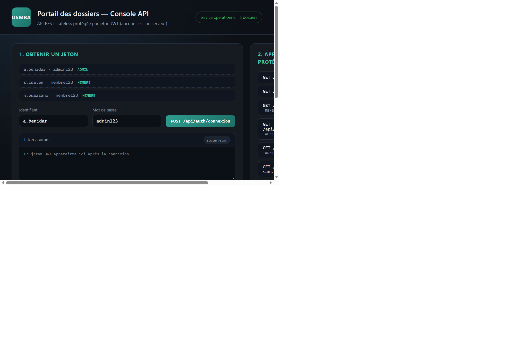
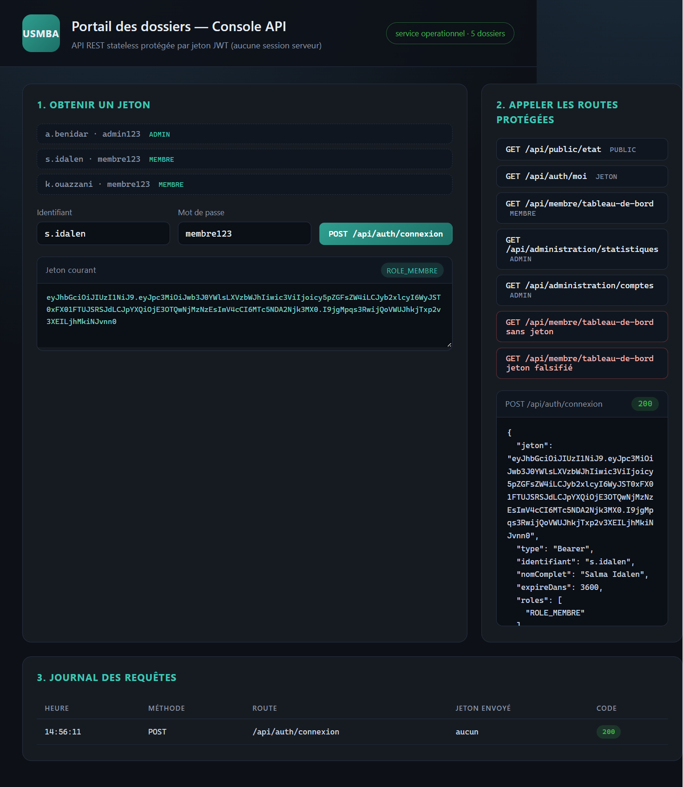
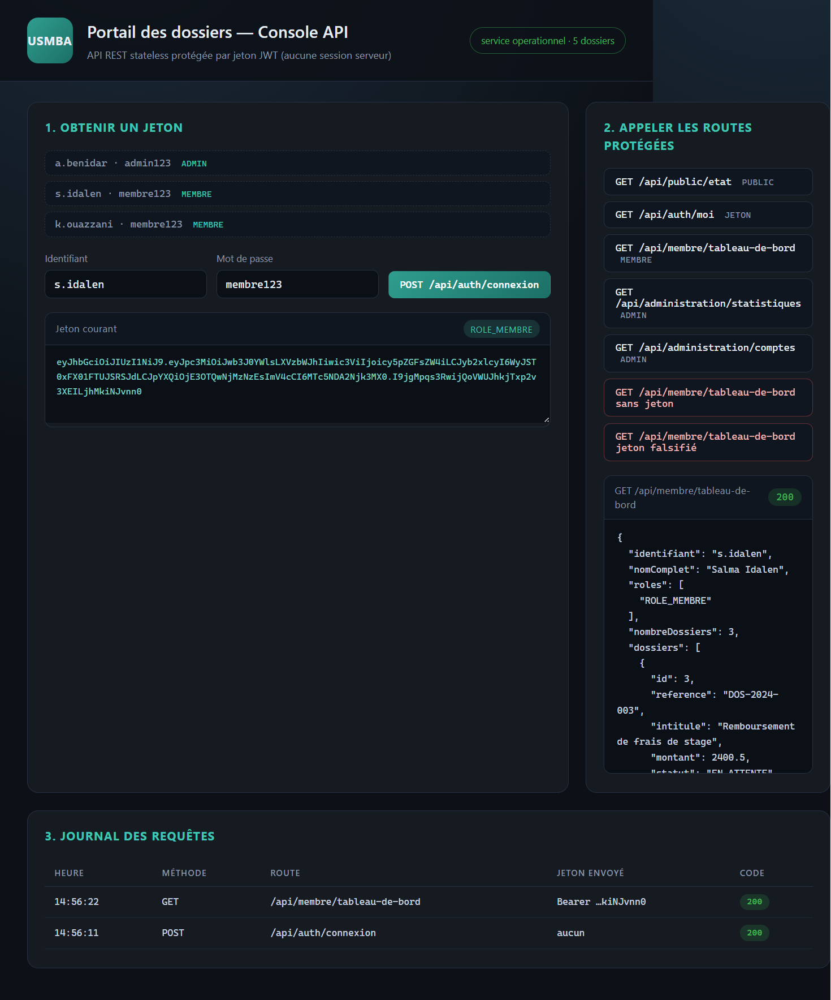
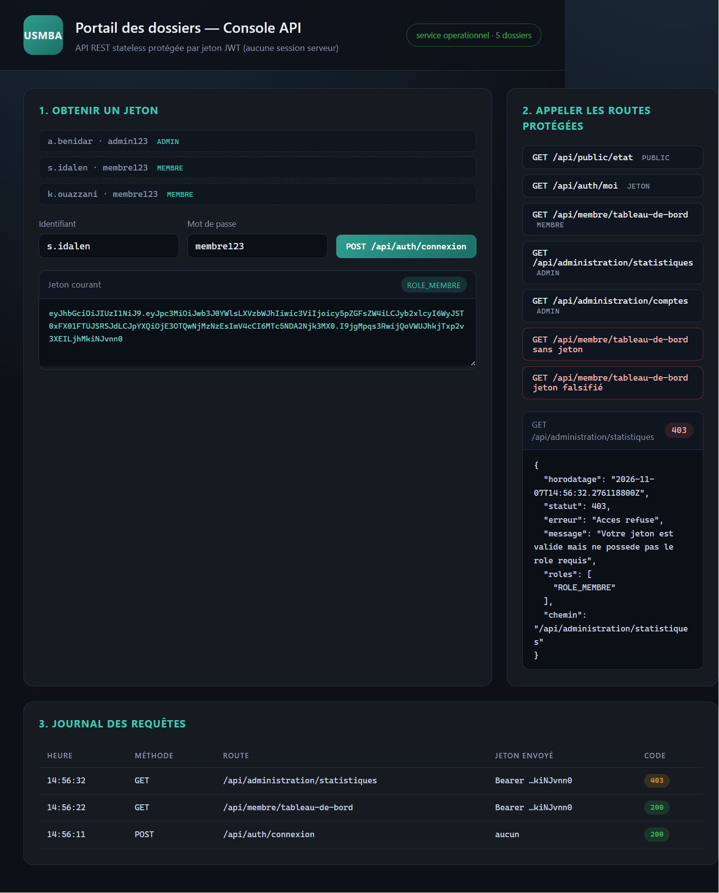
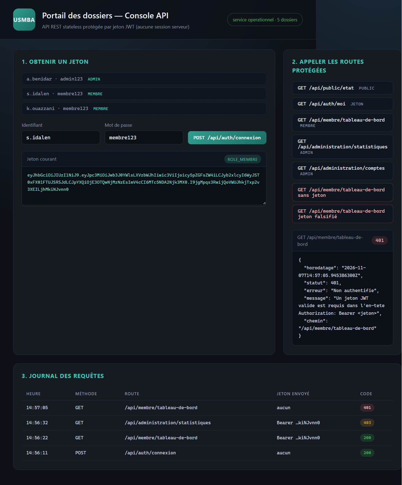
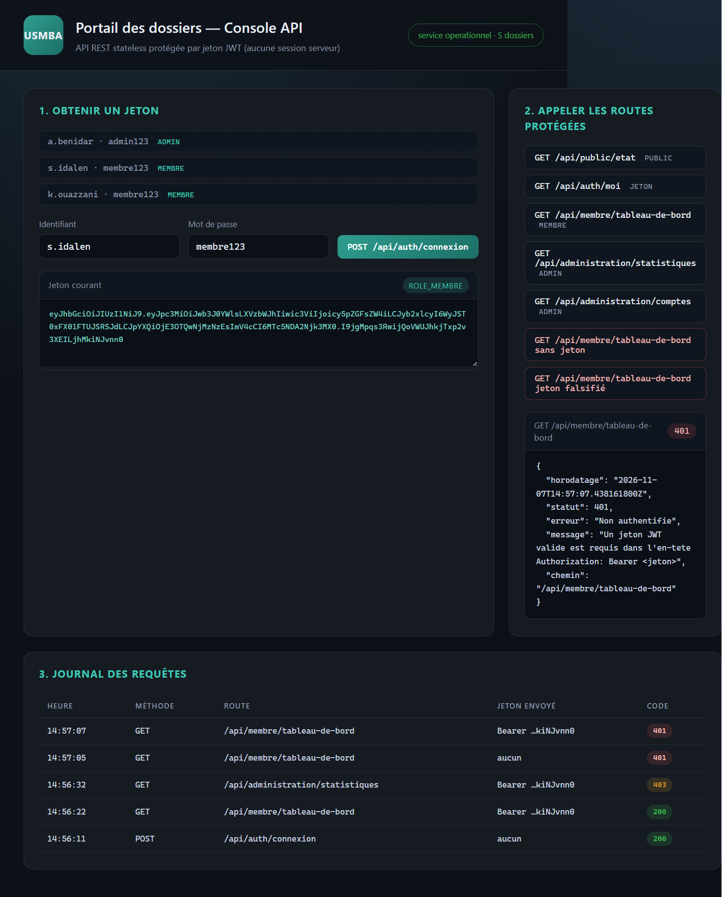
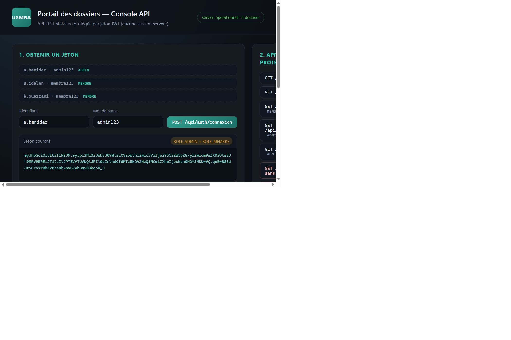
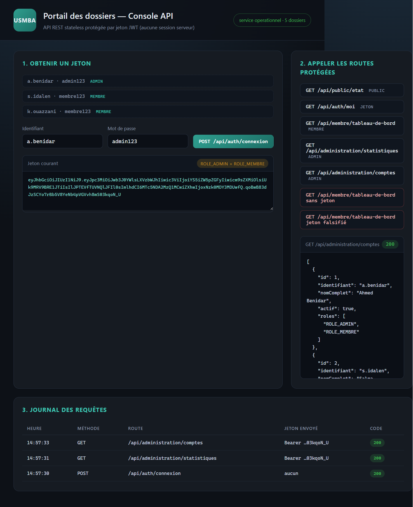

# TP 12 — API REST sécurisée avec JWT

Ce projet est une adaptation personnelle du TP 12 du cours *Développement Jakarta EE : Spring*.
L'objectif du TP est de construire une **API REST entièrement stateless** dont les routes sont
protégées par un **jeton JWT** signé, avec une authentification par identifiant / mot de passe
et une autorisation basée sur les rôles.

Le projet ne reprend pas les noms de l'énoncé : il s'appelle ici **Portail des dossiers USMBA**
et gère des dossiers administratifs déposés par des membres.

---

## Ce que fait l'application

- **Authentification** : `POST /api/auth/connexion` vérifie les identifiants (mots de passe
  hachés en BCrypt) et renvoie un jeton JWT signé en HMAC-SHA256.
- **Inscription** : `POST /api/auth/inscription` crée un compte avec le rôle `ROLE_MEMBRE`.
- **Profil** : `GET /api/auth/moi` renvoie le profil du porteur du jeton.
- **Espace membre** : `GET /api/membre/tableau-de-bord` et `GET /api/membre/mes-dossiers`
  renvoient les dossiers du membre connecté (`ROLE_MEMBRE` ou `ROLE_ADMIN`).
- **Espace administration** : `GET /api/administration/statistiques`,
  `GET /api/administration/dossiers`, `GET /api/administration/comptes` et
  `PATCH /api/administration/dossiers/{id}/statut` (`ROLE_ADMIN` uniquement).
- **État du service** : `GET /api/public/etat`, seule route réellement ouverte.
- Aucune session HTTP n'est créée : le serveur est en `SessionCreationPolicy.STATELESS`,
  chaque requête protégée doit porter l'en-tête `Authorization: Bearer <jeton>`.

Une **console HTML** (`src/main/resources/static/`) est servie à la racine du projet.
Elle n'est pas demandée par l'énoncé mais elle permet d'appeler réellement l'API depuis un
navigateur : c'est elle qui produit les captures d'écran ci-dessous.

---

## Données de démonstration

Créées automatiquement au premier démarrage par `InitialisationDonnees`.

| Identifiant | Mot de passe | Rôles | Dossiers |
|---|---|---|---|
| `a.benidar` | `admin123` | `ROLE_ADMIN`, `ROLE_MEMBRE` | 0 |
| `s.idalen` | `membre123` | `ROLE_MEMBRE` | 3 |
| `k.ouazzani` | `membre123` | `ROLE_MEMBRE`, `ROLE_OBSERVATEUR` | 2 |

Cinq dossiers `DOS-2024-001` à `DOS-2024-005` sont également insérés
(2 validés, 2 en attente, 1 refusé).

---

## Prérequis

- JDK 17 ou plus récent
- Maven 3.9+
- MySQL ou MariaDB accessible sur `localhost:3306` avec l'utilisateur `root` sans mot de passe
  (la base `portail_jeton_db` est créée automatiquement)

---

## Lancer le projet

```bash
mvn clean package
java -jar target/portail-jeton-api-1.0.0.jar
```

L'application écoute sur **http://localhost:8099**. La racine `/` ouvre la console de test.

---

## Résultats obtenus

### 1. Console au démarrage

La console se charge et interroge immédiatement la seule route publique :
le bandeau affiche `service operationnel · 5 dossiers`, ce qui confirme que la base est joignable
et que le jeu de données a bien été inséré.



### 2. Obtention d'un jeton

Connexion avec `s.idalen` : la réponse est un `200` contenant un jeton JWT, le type `Bearer`,
la durée de validité en secondes et la liste des rôles. Le jeton est conservé côté navigateur
et sera renvoyé dans l'en-tête `Authorization` des appels suivants.



### 3. Accès à l'espace membre

Avec le jeton du membre, `GET /api/membre/tableau-de-bord` répond `200` et renvoie les
3 dossiers déposés par `s.idalen`. Le serveur ne consulte aucune session : il reconstruit
l'identité à partir des *claims* du jeton à chaque requête.



### 4. Accès refusé à l'administration

Le même jeton, utilisé sur `GET /api/administration/statistiques`, donne un `403`.
L'utilisateur est bien authentifié mais il ne possède pas `ROLE_ADMIN` : c'est
l'autorisation qui échoue, pas l'authentification.



### 5. Requête sans jeton

Sans en-tête `Authorization`, la requête n'atteint jamais le contrôleur : le point d'entrée
personnalisé renvoie un `401` au format JSON avec un message explicite et le chemin demandé.



### 6. Jeton falsifié

Un jeton dont la signature a été modifiée est rejeté par le filtre : la vérification HMAC échoue
et la réponse est également un `401`. Impossible donc de s'inventer le rôle `ROLE_ADMIN`
en éditant le contenu du jeton.



### 7. Statistiques d'administration

Après connexion avec `a.benidar` (porteur de `ROLE_ADMIN`), la route réservée répond `200`
et agrège les données : 3 comptes, 5 dossiers au total, 2 en attente, 2 validés.



### 8. Liste des comptes

Toujours avec le jeton d'administration, `GET /api/administration/comptes` renvoie `200`
et la liste des comptes avec leurs rôles respectifs.



---

## Choix d'implémentation

- **Jeton** : `ServiceJeton` utilise `jjwt` 0.11.5 avec `Keys.hmacShaKeyFor` (HS256), un
  *issuer* `portail-usmba` et une durée de validité de 3 600 000 ms. Le jeton transporte un
  *claim* `roles` en plus du sujet.
- **Filtre** : `FiltreJetonJwt` étend `OncePerRequestFilter`, lit l'en-tête `Authorization`,
  recharge l'utilisateur depuis la base puis alimente le `SecurityContext`. Il positionne aussi
  des attributs de requête (`jeton.sub`, `jeton.roles`, `jeton.erreur`) pour le diagnostic.
- **Configuration** : `ConfigSecurite` déclare la chaîne de filtres, `csrf` et `cors` désactivés,
  `STATELESS`, les règles d'accès par préfixe d'URL, ainsi qu'un point d'entrée `401` et un
  gestionnaire de refus `403` tous deux en JSON.
- **Pas de cycle de beans** : le bean `PasswordEncoder` est isolé dans `ConfigEncodage` pour
  éviter la dépendance circulaire entre la configuration de sécurité et les services.
- **Propriétés typées** : `ProprietesJeton` est un `record` lié au préfixe `jeton`
  (`@ConfigurationPropertiesScan` sur la classe principale).
- **Erreurs** : `GestionnaireExceptions` centralise les réponses `400`, `401`, `404` et `409`
  au format JSON uniforme.

---

## Personnalisation par rapport à l'énoncé

| Élément | Énoncé | Ce projet |
|---|---|---|
| Groupe Maven | `ma.ens` | `ma.usmba` |
| Artefact | `spring-jwt-api` | `portail-jeton-api` |
| Package racine | `ma.ens.security` | `ma.usmba.jeton` |
| Base de données | `security_jwt` | `portail_jeton_db` |
| Port | 8080 | **8099** |
| Entité utilisateur | `User` | `Utilisateur` |
| Génération du jeton | `JwtUtil` | `ServiceJeton` + `ProprietesJeton` |
| Filtre | `JwtAuthorizationFilter` | `FiltreJetonJwt` |
| Contrôleur d'authentification | `AuthController` | `ControleurAuthentification` |
| Route de connexion | `/api/auth/login` | `/api/auth/connexion` |
| Routes protégées | `/api/user/**`, `/api/admin/**` | `/api/membre/**`, `/api/administration/**` |
| Rôles | `ROLE_USER`, `ROLE_ADMIN` | `ROLE_MEMBRE`, `ROLE_ADMIN`, `ROLE_OBSERVATEUR` |
| Domaine métier | aucun (comptes seuls) | entité `Dossier` (5 dossiers liés aux membres) |
| Vérification | Postman | console HTML réelle servie par l'application |

---

## Structure du projet

```
tp12_api_jwt_portail/
├── pom.xml
├── docs/screenshots/            captures réelles de l'application
└── src/main/
    ├── java/ma/usmba/jeton/
    │   ├── PortailJetonApplication.java
    │   ├── config/              ConfigSecurite, ConfigEncodage, 401/403 JSON, jeu de données
    │   ├── depot/               UtilisateurDepot, RoleDepot, DossierDepot
    │   ├── entite/              Utilisateur, Role, Dossier
    │   ├── jeton/               ProprietesJeton, ServiceJeton, FiltreJetonJwt
    │   ├── securite/            UtilisateurPrincipal, ServiceDetailsUtilisateur
    │   ├── service/             ServiceCompte, ServiceDossier
    │   └── web/                 contrôleurs, DTO, gestionnaire d'exceptions
    └── resources/
        ├── application.properties
        └── static/              console HTML de test (index.html, style.css, app.js)
```
